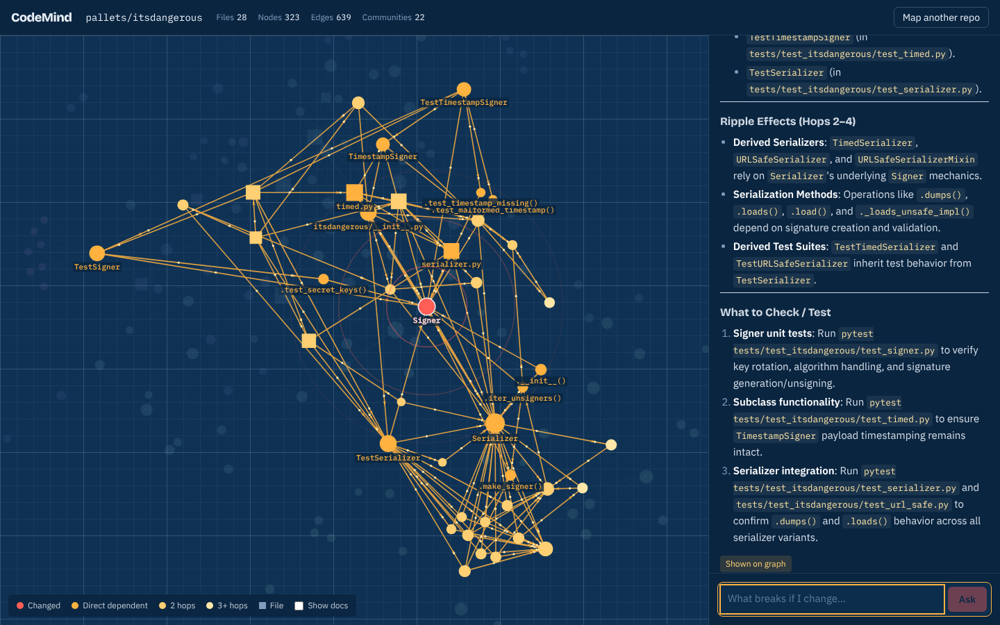

# CodeMind

**Change one thing. See everything it touches.**

CodeMind turns any public GitHub repository into a **knowledge graph built by [Graphify](https://github.com/Graphify-Labs/graphify)**. You can then ask **Gemini** questions like *"what happens if I change this module?"*. Each answer comes in two forms:

- **In chat:** a risk verdict, the direct dependents, the ripple effects by hop distance, and what to test.
- **On the graph:** the changed node glows signal-red with blast-radius rings, and every dependent lights up in amber, fading with distance. Particles flow along the dependency edges.

Built for **VibeForge 2026** (Open Innovation, Graphify track).

**Live demo: https://codemind-henna.vercel.app**: paste any public GitHub repo, or open a prebuilt graph.



## Features

- **Any public repo, any branch:** paste a URL, pick a branch from the list (default first), and switch branches from the workspace header.
- **Change-impact chat:** Gemini answers "what if I change X" with a risk level, the dependents and what to test.
- **Blast-radius graph:** the changed node in red with ripple rings, and dependents amber by hop distance.
- **Node inspector:** click any node to see who uses it, what it uses and its blast radius, then ask about it in one click.
- **Prebuilt demos:** CodeMind's own graph and Graphify's, built by Graphify.

## How it works

```
GitHub repo ──► api/graph.py (Python Vercel Function)
                 ├─ downloads tarball (codeload.github.com)
                 ├─ runs `graphify update` → graph.json + GRAPH_REPORT.md
                 └─ trims graph, extracts god nodes / surprising links / suggested questions
                         │
                         ▼
Browser holds the graph in a pure-TS GraphEngine (search · reverse-BFS impact · neighbors · path)
                         │
User question ──► /api/chat (Next.js, AI SDK + Gemini)
                 Gemini plans and calls graph tools ──► executed IN THE BROWSER against the graph
                 ◄── tool results stream back ──► Gemini writes the answer
                         │
                         ▼
Chat answer  +  graph highlight (focus / depth / path) derived from the same tool results
```

**Why client-side tools?** A real repo's graph can be several MB. Instead of uploading it on every message, Gemini sends tool calls (`analyzeImpact`, `searchNodes`, `getNeighbors`, `findPath`), and the browser answers them from the graph it already holds. The server stays stateless, with no database, and the highlight on the graph comes from exactly the data Gemini reasoned over.

### How Graphify is used

| Graphify output | Where CodeMind uses it |
|---|---|
| `graph.json` nodes/edges (calls, imports, inherits, method, references…) | Every impact, path and neighbour query, plus the graph you see |
| Communities (Leiden clustering) | Node colouring and "in <community>" context in the inspector |
| `GRAPH_REPORT.md` god nodes | Grounding in Gemini's system prompt (core abstractions) |
| `GRAPH_REPORT.md` surprising connections | Grounding in Gemini's system prompt |
| `GRAPH_REPORT.md` suggested questions | Starter questions in the chat |
| Graphify run on CodeMind's own source | The built-in "CodeMind itself" demo graph (dogfooding) |

## Run locally

Requirements: Node 22+, Python 3.11+.

```bash
npm install
pip install -r requirements.txt
export Gemini=<your Gemini API key>   # or GEMINI_API_KEY
npm run dev:api   # Python Graphify function on :8000
npm run dev       # Next.js on :3000 (proxies /api/graph to :8000)
```

Rebuild the demo graphs with Graphify:

```bash
python scripts/build_demo.py . codemind "CodeMind (this app)"
```

## Tests

The tests were written first, test-driven: 26 vitest tests and 21 pytest tests.

```bash
npm test          # graph engine, Gemini tool runner, highlight mapping, chat route, prompt
npm run test:py   # repo URL parsing, safe tar extraction, graph trimming, report parsing
```

## Configuration

| Variable | Purpose |
|---|---|
| `Gemini` / `GEMINI_API_KEY` | Gemini API key (required for chat) |
| `GEMINI_MODEL` | Optional model override (default `gemini-3.5-flash`) |
| `GITHUB_TOKEN` | Optional, raises GitHub download rate limits |

Limits: public repos, ≤ 60 MB tarball, ≤ 4000 source files; graphs over 9000 nodes keep code first.

## Project structure

```
api/graph.py, api/_codemind.py   Python: download → Graphify → trim (Vercel Python Function)
app/api/chat/route.ts            Gemini streaming endpoint (tool schemas, no server state)
lib/graph/engine.ts              Graph engine: normalize, search, impact (reverse BFS), path, stats
lib/ai/graph-tools.ts            Tool schemas + browser-side tool runner
lib/ai/highlight.ts              Tool results → graph highlight
components/                      Landing, Workspace, GraphView (force graph + ripple), ChatPanel, NodePanel
docs/superpowers/                Design spec and implementation plan
PROMPTS.md                       Full AI prompt history (VibeForge rule §3)
```

## Disclosure of pre-existing code and resources (VibeForge rule §3)

- **Next.js starter:** scaffolded with `create-next-app` (layout boilerplate, configs). All application code was written during the event.
- **Graphify** (`graphifyy` on PyPI, Graphify-Labs/graphify): the knowledge-graph engine, used as a dependency and not modified.
- **Libraries:** Vercel AI SDK + `@ai-sdk/google` (Gemini), `react-force-graph-2d`, `react-markdown`, Tailwind CSS, Zod, Vitest, pytest.
- **Fonts:** Bricolage Grotesque, IBM Plex Sans, IBM Plex Mono (Google Fonts, OFL).
- **AI assistance:** built with Claude Code (Anthropic) using the superpowers planning/TDD skills, frontend-design and Vercel deploy skills. Every prompt is in [PROMPTS.md](PROMPTS.md).
